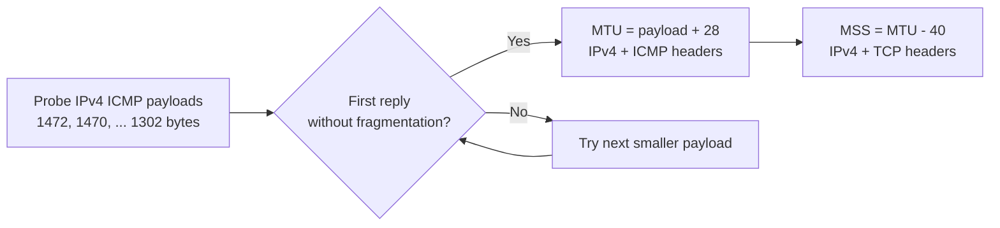

# MTU / MSS Finder

A small Python script that probes one IPv4 path with ICMP echo requests using the **Don't Fragment** flag, then prints a suggested path MTU and TCP MSS. It uses only the Python standard library and your system's `ping` command.

## Run

```bash
python MTU-Finder.py
```

The target is currently set to `8.8.8.8` in the final line of [`MTU-Finder.py`](MTU-Finder.py). Edit that argument to test a different reachable destination. The script has no command-line flags yet.

## How the estimate is calculated



For example, a successful 1472-byte payload gives an estimated MTU of 1500 and MSS of 1460 for a basic IPv4/TCP path without extra options or encapsulation.

## Current limits

- The implemented `ping` commands target **Windows and Linux**. The non-Windows branch uses Linux's `-M do` option, so macOS support is not implemented.
- It tests only one destination, starts at a 1500-byte MTU, decreases in two-byte steps, and stops after a 1302-byte payload. A lower-MTU path will produce “No optimal size found.”
- ICMP filtering, rate limiting, asymmetric routes, and tunnel overhead can make the estimate misleading. A failed probe does not prove the path MTU.
- The calculation assumes IPv4 and fixed 20-byte IP/TCP headers. IPv6 and TCP options need different handling.
- This is a diagnostic estimate; validate any MSS setting against the actual application path before applying it to a firewall or router.

## Next improvements

Accept the target and probe range as CLI arguments, check `ping` exit codes and platform-specific errors, add macOS support, and use a bounded binary search with a repeat count instead of a linear one-shot scan.

## License

See [`LICENSE`](LICENSE).
